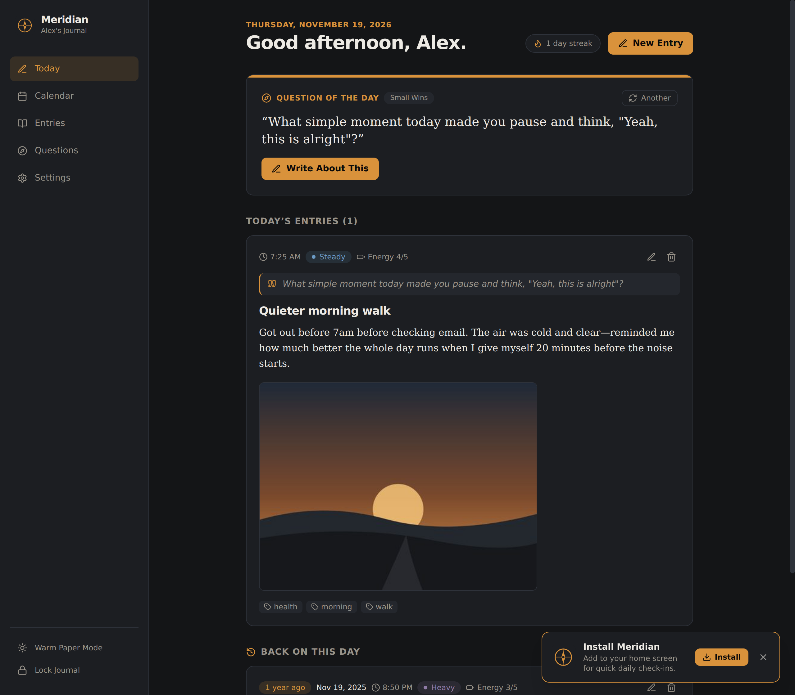
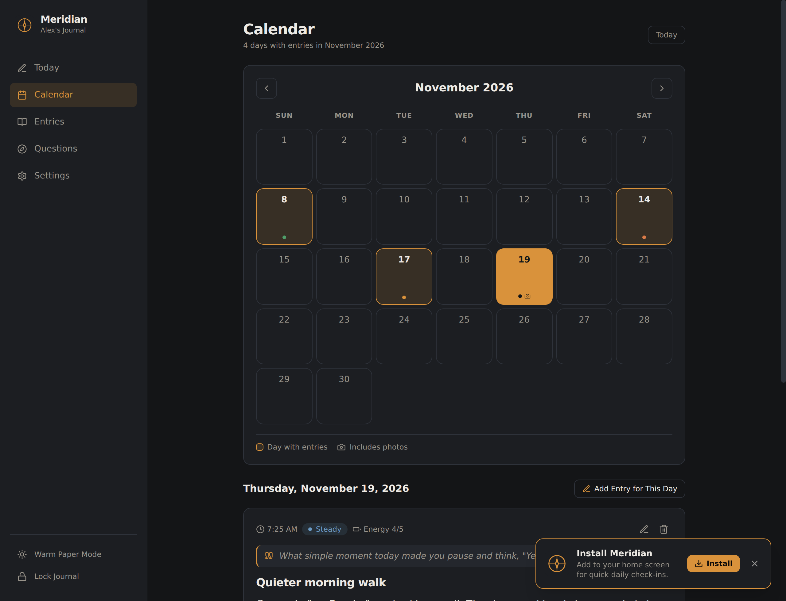

# Meridian

**A quiet, private, self-hosted daily journal built for men navigating midlife (45–60).**

[](https://buymeacoffee.com/marcjc1173)

---

## Why Meridian Exists

Midlife hits differently than people talk about. Somewhere between 45 and 60, a lot of men find themselves carrying a heavy mix of things at once—work and purpose shifting, bodies changing, kids growing up or leaving, parents aging, friendships quietly fading, and the feeling that you're supposed to just keep your head down and push through it.

Writing helps. Getting what's looping in your head onto a page—without performing for anyone, without a subscription, and without a third-party company storing your most honest thoughts—takes some of the weight off.

Most journaling apps are either cloud subscriptions, generic blank pages, or filled with prompts that don't fit where you actually are in life. **Meridian** is built to be the opposite:

- **100% self-hosted & private** — your entries and photos live in a single `./data` folder on your own machine or home server.
- **Grounded, midlife-focused daily questions** — 64+ prompts written specifically for men in their 45–60s, for the days you sit down and don't know where to start.
- **Low friction** — open it, write two sentences or two pages, drop in a photo, check in on your mood/energy if you want, and close it.

---

## Screenshots

### Today — Question of the Day, Entries with Photos & Back on This Day


### Calendar View — Past Entries & Photo Indicators at a Glance


---

## Features

- **Daily Writing & Photos**: Exact date and time tracking (including backdating and multiple entries per day), drag-and-drop or mobile photo uploads with automatic thumbnails and full-screen lightbox.
- **Question of the Day**: Consistent daily reflection prompt across 7 grounded themes (*Carrying Weight*, *Next Chapter*, *Health & Energy*, *Relationships*, *Perspective*, *Small Wins*, *Values & Legacy*), with one-click shuffle and custom prompt management.
- **Back on This Day**: Automatically surfaces entries from the same date in previous years (plus a one-month throwback while your journal is new) so you can see how far you've come.
- **Calendar View**: Monthly calendar where days with entries stand out visually with mood and photo indicators. Click any day to read or add entries.
- **Mood, Energy, Search & Tags**: Plain-spoken 1-click mood check-in (*Good, Steady, Grateful, Stressed, Heavy, Low*), optional 1–5 energy level, full-text search, and tag filtering.
- **Private Lock + Phone Passkeys**: Single-user password/PIN lock plus **WebAuthn Passkey** support so you can unlock on your phone with Face ID, Touch ID, or fingerprint.
- **Warm & Grounded Themes**: Switch between **Dark Charcoal** and **Warm Paper** modes, with PWA support so you can add it to your phone's home screen.

---

## Quick Start (Docker — Recommended)

```bash
git clone https://github.com/marcjc1173/meridian-journal.git
cd meridian-journal
docker compose up -d --build
```

Then open `http://localhost:3001` (or `http://<your-server-ip>:3001`) to set your password/PIN and start writing.

### Backups (Local & Google Drive via `rclone`)
Everything—your SQLite database (`meridian.db`) and all uploaded photos—lives inside `./data`. Back up that single folder and you have your entire journal.

Meridian also includes [`scripts/backup.sh`](./scripts/backup.sh), which takes a safe live SQLite snapshot (so the database is never copied mid-write) and syncs it along with your photos to **Google Drive** (or Dropbox, OneDrive, S3, Backblaze B2) using [`rclone`](https://rclone.org/):

1. Install `rclone` (`sudo apt install rclone` or `brew install rclone`) and link Google Drive:
   ```bash
   rclone config
   # Choose: n (New remote) → Name: gdrive → Storage: drive (Google Drive)
   ```
   *(Optional: wrap `gdrive` in an `rclone crypt` remote if you want end-to-end encrypted backups before upload.)*
2. Run a backup anytime:
   ```bash
   RCLONE_REMOTE="gdrive:MeridianBackup" ./scripts/backup.sh
   ```
3. Automate nightly backups with a `cron` job or `systemd` user timer:
   ```bash
   # Example crontab entry (2:00 AM daily):
   0 2 * * * RCLONE_REMOTE="gdrive:MeridianBackup" /path/to/meridian-journal/scripts/backup.sh
   ```

### Enabling Phone Passkeys (Face ID / Touch ID / Fingerprint)
Browsers require **HTTPS + a hostname** to use Passkeys outside `localhost`. Two easy ways to enable HTTPS for your self-hosted instance:

1. **Tailscale Serve (easiest private setup):**
   ```bash
   tailscale serve --bg 3001
   ```
   This gives you a private `https://<your-machine>.<your-tailnet>.ts.net` URL reachable only on your devices. Passkeys will work automatically.

2. **Reverse Proxy (Caddy / Nginx):**
   Proxy your domain to port `3001` with HTTPS, and optionally set `RP_ID` and `ORIGIN` in `docker-compose.yml`:
   ```yaml
   environment:
     - RP_ID=journal.yourdomain.com
     - ORIGIN=https://journal.yourdomain.com
   ```

---

## Local Development (Without Docker)

Requires **Node.js 22+**.

```bash
npm run install:all
npm run build
npm start
```

Or run the backend and frontend dev servers with hot reload:
```bash
npm run dev:server
npm run dev:client
```

---

## Contributing

Contributions are welcome—especially **new midlife reflection prompts** (see `server/src/prompts.ts`), UI polish, and export/backup features. Keep the tone honest, grounded, and practical.

## Support

Meridian is free and open-source. If it's been helpful to you and you'd like to support its development, you can [buy me a coffee](https://buymeacoffee.com/marcjc1173).

## License

[MIT](./LICENSE)
